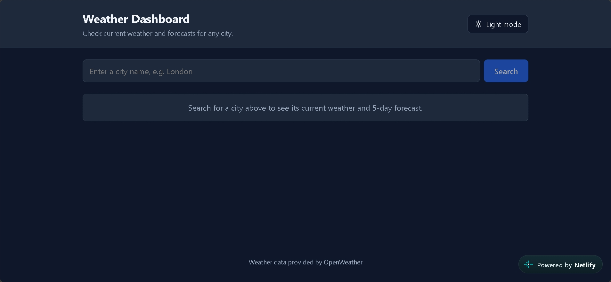
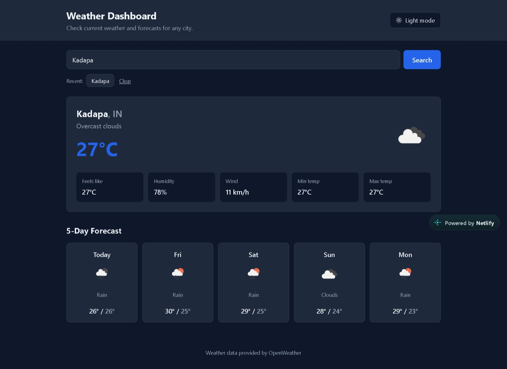

# 🌦️ Weather Dashboard

A simple and responsive Weather Dashboard built using React and Vite. This project allows users to search for weather information and view forecasts through a clean and user-friendly interface.

## 🌐 Live Demo

🔗 **Live Website:** https://weatherdashboard-23.netlify.app/

📂 **GitHub Repository:** https://github.com/vankayalavamsi/Weather-Dashboard

## 📸 Screenshots

### Home Page



### Dashboard



## ✨ Features

* 🔍 Search for weather information by city.
* 🌡️ View current weather details.
* 🌤️ Check weather forecasts.
* 🌓 Theme handling.
* 📱 Responsive user interface.
* 🧩 Reusable React components.
* 🎨 Simple and clean design.

## 🛠️ Technologies Used

* React.js
* Vite
* JavaScript
* CSS
* Weather API
* Git and GitHub
* Netlify

## 📁 Project Structure

```text
Weather-Dashboard/
├── public/
├── screenshots/
│   ├── home.png
│   └── dashboard.png
├── src/
│   ├── components/
│   │   ├── CurrentWeather.jsx
│   │   ├── Forecast.jsx
│   │   ├── ForecastCard.jsx
│   │   ├── Header.jsx
│   │   └── SearchBar.jsx
│   ├── hooks/
│   │   └── useTheme.js
│   ├── utils/
│   │   └── weather.js
│   ├── App.jsx
│   ├── index.css
│   └── main.jsx
├── .env.example
├── index.html
├── package.json
├── package-lock.json
└── vite.config.js
```

## 💻 Run the Project Locally

Follow these steps to download and run the project on your computer.

### Step 1: Install the Requirements

Make sure you have installed:

* [Node.js](https://nodejs.org/) (preferably an LTS version).
* Git.

You can check whether Node.js and npm are installed by running:

```bash
node -v
npm -v
```

### Step 2: Clone the Repository

Open your terminal or command prompt and run:

```bash
git clone https://github.com/vankayalavamsi/Weather-Dashboard.git
```

### Step 3: Open the Project Folder

```bash
cd Weather-Dashboard
```

### Step 4: Install Dependencies

Run the following command to install all the required packages:

```bash
npm install
```

### Step 5: Create the `.env` File

**Important:** You need to create your own `.env` file in the project's root directory before running the application if your local setup requires an API key.

The `.env.example` file is provided as a reference.

On Windows, you can create the file using:

```bash
copy .env.example .env
```

Alternatively, create a new file named `.env` manually in the same folder as `package.json`.

Your project folder should look like this:

```text
Weather-Dashboard/
├── .env
├── .env.example
├── package.json
└── src/
```

### Step 6: Configure Your API Key

Open the `.env` file and add your own weather API key using the variable name expected by the project.

For example:

```env
VITE_WEATHER_API_KEY=your_api_key_here
```

Replace `your_api_key_here` with your actual API key.

**Note:** This is an example variable name. Check `.env.example` and `src/utils/weather.js` to confirm the exact variable name and API provider used by this project. If the project already defines a different variable name, use that instead.

If you need an API key, obtain one from the weather API provider used by the application.

**Important:**

* Never upload your real `.env` file or API secrets to GitHub.
* Do not share your API key publicly.
* If you change environment variables, restart the development server.

### Step 7: Start the Development Server

Run:

```bash
npm run dev
```

Vite will display a local URL in your terminal.

Usually, it will be:

```text
http://localhost:5173
```

Open this URL in your browser to use the Weather Dashboard.

## 🧩 Main Components

| File                 | Description                                 |
| -------------------- | ------------------------------------------- |
| `App.jsx`            | Main application component.                 |
| `Header.jsx`         | Displays the application header.            |
| `SearchBar.jsx`      | Provides the city search interface.         |
| `CurrentWeather.jsx` | Displays current weather information.       |
| `Forecast.jsx`       | Handles the weather forecast section.       |
| `ForecastCard.jsx`   | Displays forecast information in a card.    |
| `useTheme.js`        | Contains theme-related functionality.       |
| `weather.js`         | Contains weather-related utility functions. |
| `index.css`          | Contains the global styles.                 |
| `main.jsx`           | Entry point of the React application.       |

## 📚 What I Learned

Through this project, I gained practical experience with:

* Building user interfaces with React.
* Creating reusable components.
* Using JavaScript for application logic.
* Working with weather APIs.
* Using React hooks.
* Styling applications with CSS.
* Setting up a project with Vite.
* Managing code with Git and GitHub.
* Deploying a website using Netlify.

## 🚀 Future Improvements

* Add more detailed weather information.
* Improve the mobile interface.
* Display additional forecast details.
* Improve error handling for invalid city names.
* Add more weather-related features.

## 👨‍💻 Author

**Vankayalavamsi**

* GitHub: https://github.com/vankayalavamsi

## 📝 Conclusion

This Weather Dashboard is a learning project developed to practice React, JavaScript, API integration, and frontend development.

The project helped me understand how to build, organize, and deploy a web application. I plan to continue improving it as I learn more about web development.
